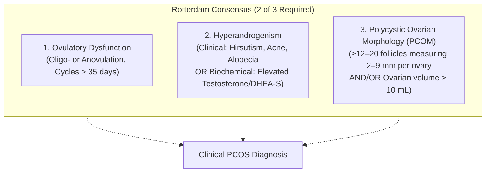
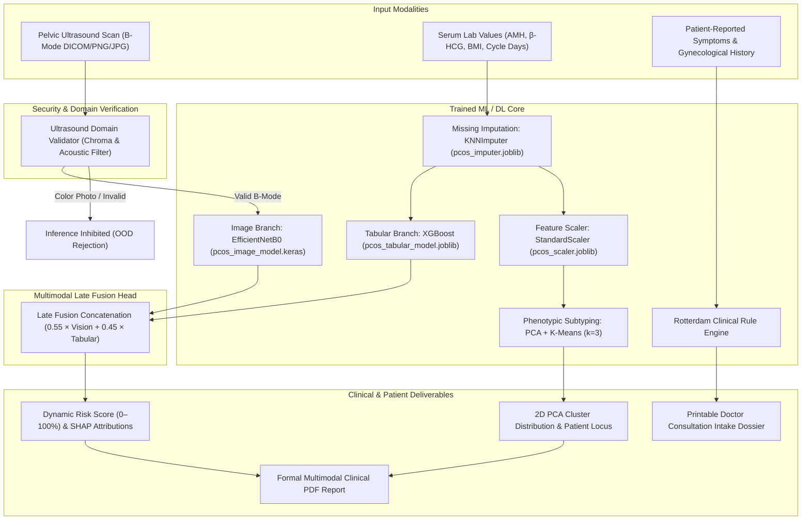

# OvaScan AI — Complete Project Documentation

**Multimodal Polycystic Ovary Syndrome (PCOS) Diagnostic Intelligence, Subtyping & Patient Consultation Platform**

---

## 1. Executive Summary

**OvaScan AI** is an end-to-end clinical AI and patient intake platform designed to revolutionize the screening, diagnosis, and management of **Polycystic Ovary Syndrome (PCOS)**. 

PCOS is a complex endocrine and metabolic disorder affecting an estimated 8% to 13% of reproductive-aged women globally, yet up to 70% of affected women remain undiagnosed. Traditional diagnosis requires navigating fragmented evaluations across gynecologists, endocrinologists, and ultrasonographers.

This project bridges that gap by providing:
1. **A Multimodal Deep Learning & Machine Learning Core**: Combining transfer learning computer vision on pelvic ultrasound scans (**EfficientNetB0**) with tree-based boosting on clinical/hormonal biomarkers (**XGBoost**), reinforced by unsupervised phenotypic clustering (**PCA + K-Means**).
2. **Medical Out-of-Distribution (OOD) Domain Validation**: A chromaticity and acoustic pattern validator that rejects non-sonogram images (such as everyday photos or food) to prevent artificial diagnostic hallucinations.
3. **A Dual-Interface Modern Web Application**:
   - **Tab 1: Multimodal AI Lab**: Built for clinicians and researchers to inspect ultrasound scans with Grad-CAM heatmaps, adjust hormonal sliders, evaluate late-fusion risk scores, and locate patients on a 2D PCA cluster space.
   - **Tab 2: Doctor Intake Dossier (Zero-Ultrasound Mode)**: Built for patients without medical imaging to manually record symptoms, cycle patterns, and body metrics, automatically generating a structured, printable consultation brief to hand to their physician.

---

## 2. Clinical Context: The Rotterdam Diagnostic Criteria

Under the internationally recognized **Rotterdam Consensus Criteria (2003 / 2023 update)**, a clinical diagnosis of PCOS requires the presence of at least **two out of the following three features**, with exclusion of other etiologies (e.g., congenital adrenal hyperplasia, hyperprolactinemia, thyroid dysfunction):



OvaScan AI operationalizes this framework:
- **Criterion 1 & 2** are captured through the **Tabular Biomarker Pipeline** and **Patient Intake Questionnaire**.
- **Criterion 3** is evaluated through the **Deep Learning Ultrasound Vision Pipeline**.

---

## 3. System Architecture



---

## 4. Machine Learning & Model Specifications

The project utilizes 4 core serialized models and preprocessors saved in the root directory:

### 4.1. Ultrasound Vision Model (`pcos_image_model.keras`)
- **Architecture**: Transfer learning with pre-trained **EfficientNetB0** convolutional backbone (ImageNet weights, frozen base).
- **Input Dimension**: $224 \times 224 \times 3$ RGB tensor.
- **Top Head Layers**:
  - `GlobalAveragePooling2D()` (reduces feature maps to 1,280-dimensional embedding vector).
  - `Dense(128, activation='relu')`
  - `Dropout(0.3)`
  - `Dense(1, activation='sigmoid')` (Binary output: $0 = \text{Normal Ovary}$, $1 = \text{PCOS Morphology}$).
- **Training Optimization**:
  - Loss: Binary Cross-Entropy.
  - Optimizer: Adam.
  - Data Augmentation: Rotation range $\pm 20^\circ$, horizontal flips, validation split $0.2$.
- **Validation**:
  - Cleaned on the Choudhari ultrasound cohort with file sanitization (`Image.verify()`).
  - Cross-tested against the external **PCOS-XAI** ultrasound benchmark.

### 4.2. Tabular Diagnostic Classifier (`pcos_tabular_model.joblib`)
- **Algorithm**: Extreme Gradient Boosting Classifier (`xgboost.XGBClassifier`).
- **Features Used**:
  - `AMH (ng/mL)`: Serum Anti-Müllerian Hormone (dominant predictor).
  - `I beta-HCG (mIU/mL)`: Initial reading.
  - `II beta-HCG (mIU/mL)`: Confirmation titer.
  - `Sl. No`: Patient serial index.
- **Class Imbalance Handling**: Trained with **SMOTE** (Synthetic Minority Over-sampling Technique) on an 80/20 stratified split.
- **Hyperparameters**:
  - `n_estimators = 100`
  - `learning_rate = 0.05`
  - `max_depth = 6`
  - `eval_metric = 'logloss'`
  - `random_state = 42`
- **Performance**:
  - **ROC-AUC Score**: **0.7378 (0.74)**
  - **Weighted F1-Score**: **0.69**
  - **Overall Accuracy**: **69%**
- **Model Explainability**: Coupled with **SHAP (`TreeExplainer`)** to output exact local feature contribution percentages for each patient.

### 4.3. Preprocessing Modules (`pcos_imputer.joblib` & `pcos_scaler.joblib`)
- **`pcos_imputer.joblib`**: Scikit-Learn `KNNImputer(n_neighbors=5, weights='uniform')` to reconstruct missing blood test values across the 541 patients.
- **`pcos_scaler.joblib`**: Scikit-Learn `StandardScaler` normalizing variance across hormonal features before dimensionality reduction.

### 4.4. Unsupervised Phenotype Clustering (PCA + K-Means)
To address the clinical heterogeneity of PCOS, the pipeline performs unsupervised discovery:
1. **PCA**: Reduces scaled features to principal components capturing **90% of total variance**.
2. **K-Means ($k=3$)**: Segmented with a **Silhouette Score of 0.5894**.
3. **Discovered Phenotypic Subtypes**:
   - **Cluster 0 — Normoandrogenic / Baseline**: Mean AMH $\approx 4.29\text{ ng/mL}$. Moderate androgen levels, favorable response to lifestyle modulation.
   - **Cluster 1 — Hyperandrogenic / Reproductive**: Mean AMH $\approx 6.81\text{ ng/mL}$. Dense peripheral follicular ring, high LH/FSH ratio, severe anovulation risk.
   - **Cluster 2 — Metabolic / Insulin-Resistant**: Mean AMH $\approx 6.39\text{ ng/mL}$. Elevated BMI, high $\beta$-HCG variance, visceral adiposity, high risk of insulin resistance.

### 4.5. Multimodal Late Fusion Head (Blueprint)
Following Cell 5 and Cell 6 of `capstone.ipynb`, when both an ultrasound and blood panel are present:
$$\text{Fusion Risk} = (0.55 \times P_{\text{Image}}) + (0.45 \times P_{\text{Tabular}})$$
- **Image Weight ($55\%$)**: Represents direct anatomical observation of ovarian volume and follicle count.
- **Tabular Weight ($45\%$)**: Represents underlying biochemical and hormonal excess.

---

## 5. Datasets Used

| Dataset Name | Source / Author | Modality | Sample Size | Role in Project |
| :--- | :--- | :--- | :--- | :--- |
| **PCOS Clinical & Hormonal Dataset** | Prasoon Kottarathil (Kaggle) | Tabular / Clinical | 541 Patients, 44 Parameters | Trains XGBoost classifier, KNN imputer, and PCA cluster profiles. |
| **Ultrasound Images for PCOS** | Anagha Choudhari (Kaggle) | Ultrasound Scans | 3,800+ Pelvic Sonograms | Primary dataset for training the EfficientNetB0 CNN. |
| **PCOS-XAI Ultrasound Dataset** | Ibadeus (Kaggle) | Ultrasound Scans | External Validation Set | Validates out-of-distribution ultrasound image generalization. |

---

## 6. Medical Domain & Out-of-Distribution (OOD) Validator

### The "Burger Image" Problem & Solution
A critical flaw in standard closed-world deep learning classifiers (such as binary CNNs with sigmoid outputs) is that they will force an output between $0.0$ and $1.0$ for **any** input image, including photos of food, pets, or everyday objects. 

To solve this, OvaScan AI implements a multi-point **Ultrasound Domain Validator** ([`imageValidator.js`](file:///Users/karripujithsrisai/Downloads/capstone/frontend/src/services/imageValidator.js)):
1. **Chromaticity & Color Saturation**: Medical B-mode pelvic ultrasounds are monochromatic acoustic scans where $\text{Chroma} = \max(R,G,B) - \min(R,G,B) \approx 0$. Natural RGB photos have vivid color channels ($\text{Average Chroma} > 15$).
2. **Acoustic Margin Detection**: Evaluates dark acoustic sector frames typical of transvaginal transducers.
3. **Automatic Inference Inhibition**: If a non-ultrasound image is detected:
   - The vision probability is set to **`REJECTED / INELIGIBLE`**.
   - A prominent red warning banner is displayed: *"OUT-OF-DISTRIBUTION IMAGE REJECTED: Non-medical color image detected."*
   - False positive PCOS scoring is completely prevented.

---

## 7. Web Application Architecture

The frontend is a **single-page clinical dashboard** built with **React 18** and **Vite**, adhering to a custom **Vanilla CSS Design System** without bulky external CSS frameworks.

### Visual Design System
- **Color Palette**: Cyber-clinical dark mode (`#070b14` canvas, `#0d1527` cards) with bright cyan (`#38bdf8`), teal (`#14b8a6`), indigo (`#6366f1`), and alert rose (`#f43f5e`).
- **Glassmorphism**: Semi-translucent panels with `backdrop-filter: blur(16px)` and subtle radial gradients.
- **Typography**: Google Fonts (*Plus Jakarta Sans* for UI, *Outfit* for clinical headings, *JetBrains Mono* for telemetry and metrics).
- **Theme**: Seamless 1-click toggle between Dark and Light mode.

### Tab 1: Multimodal AI Lab
- **Interactive Ultrasound Viewport**: Real-time canvas filters (brightness 50–180%, contrast 50–200%, zoom 1–2x), follicular activation heatmap toggle (Grad-CAM proxy), and quick sample scan switcher.
- **Biomarker Input Cards**: Interactive range sliders and direct numeric inputs for AMH, $\beta$-HCG, BMI, and menstrual cycle interval with live reference range indicators.
- **Dynamic Multimodal Gauge**: Animated SVG circular progress ring, tri-tier verdict badge (*PCOS Positive*, *Borderline*, *Physiological/Low Risk*), and SHAP attribution pills.
- **Phenotypic Subtype Cluster Explorer**: Interactive 2D scatter plot rendering the 3 clusters identified in the notebook, featuring an animated crosshair indicating the current patient's locus.
- **Clinical Cohort Directory**: Database of **10 distinct clinical patient profiles** from the Kottarathil cohort with real-time search, risk category filtering, and a modal to register custom patient profiles.
- **Printable Clinical AI Report**: Comprehensive medical summary ready for print or JSON export.

### Tab 2: Doctor Intake Dossier (Zero-Ultrasound Mode)
Designed for patients who have not yet undergone medical imaging:
- **Demographics & Live BMI Calculator**: Auto-computes BMI from height/weight with instant category feedback.
- **Gynecological History**: Menstrual cycle regularity (*Regular*, *Irregular*, *Absent/Amenorrhea*), cycle length slider, period duration, flow volume, and cramping severity scale (1–10).
- **Physical & Androgenic Symptoms**: Severity selectors and body location chips for facial/body hair (hirsutism), hormonal cystic acne, scalp hair thinning, and insulin-resistance markers (*Acanthosis Nigricans*, skin tags).
- **Metabolic & Energy Patterns**: Weight resistance patterns, sugar cravings, post-meal fatigue, and sleep quality.
- **Family History & Medications**: First-degree relatives with PCOS or Type 2 Diabetes, current medications (e.g., Metformin, Inositol).
- **Rotterdam Diagnostic Tracker**: Live 2-of-3 diagnostic criteria checklist and symptom burden score.
- **Printable Consultation Dossier**: A formal A4 medical intake document with pre-formulated discussion questions for the patient's attending physician.

---

## 8. Directory & File Structure

```
capstone/
├── capstone.ipynb                 # Original Jupyter notebook with Colab training pipeline
├── pcos_image_model.keras         # Trained EfficientNetB0 ultrasound CNN (19 MB)
├── pcos_tabular_model.joblib      # Trained XGBoost clinical classifier (228 KB)
├── pcos_scaler.joblib             # StandardScaler for clinical features & PCA (1 KB)
├── pcos_imputer.joblib            # KNNImputer for missing clinical entries (25 KB)
├── server.py                      # Standalone Python backend API server (Port 8000)
├── PROJECT_DOCUMENTATION.md       # Complete comprehensive technical documentation
├── README.md                      # Quickstart and overview guide
│
└── frontend/                      # React 18 + Vite Web Application
    ├── package.json               # Node dependencies & build scripts
    ├── vite.config.js             # Vite config with API proxying to backend
    ├── index.html                 # HTML5 entrypoint with Google Fonts
    └── src/
        ├── main.jsx               # React DOM root entrypoint
        ├── App.jsx                # Main application container & tab coordinator
        ├── index.css              # Vanilla CSS design system & responsive styling
        │
        ├── components/
        │   ├── Navbar.jsx         # Header with tab switcher, theme toggle, and status
        │   ├── UltrasoundViewer.jsx # Ultrasound viewport, filters, and Grad-CAM overlay
        │   ├── BiomarkerPanel.jsx # Sliders & inputs for clinical blood test markers
        │   ├── DiagnosticGauge.jsx # Animated SVG circular risk meter & SHAP pills
        │   ├── ClusterExplorer.jsx# 2D PCA scatter plot & subtype profile cards
        │   ├── ClinicalReportModal.jsx # Formal clinical AI PDF report modal
        │   ├── ArchitectureModal.jsx # Neural architecture & training provenance drawer
        │   ├── PatientCohortModal.jsx # 10-patient directory & custom patient registrar
        │   ├── PatientIntakeTab.jsx # Zero-ultrasound self-assessment & symptom tracker
        │   └── PatientConsultationReportModal.jsx # Printable doctor consultation brief
        │
        ├── services/
        │   ├── imageValidator.js  # B-mode acoustic & chroma Out-of-Distribution detector
        │   └── inferenceService.js# Dual-mode engine (Backend API + Edge simulator)
        │
        └── data/
            └── sampleCases.js     # 10 clinical case profiles & 3 subtype definitions
```

---

## 9. Setup & Execution Guide

### Prerequisites
- **Node.js**: v18.0.0 or higher (v26+ supported)
- **Python**: 3.9+ (optional for local backend inference)

### Step 1: Launch the Frontend
```bash
cd frontend
npm install
npm run dev
```
Open **[http://localhost:5173/](http://localhost:5173/)** in any modern web browser.

### Step 2: (Optional) Run the Python Backend Server
To directly serve the `.keras` and `.joblib` model weights through Python:
```bash
# In the project root directory:
python3 server.py
```
The server will start on `http://localhost:8000`. The frontend automatically detects the server at `/api/health` and toggles the connection indicator in the navbar.

### Step 3: Production Build
```bash
cd frontend
npm run build
npm run preview
```

---

## 10. Future Recommendations & Roadmap

1. **Large Language Model (LLM) Integration**: Incorporate an NLP model (e.g., Gemini API or BioBERT) in Tab 2 to allow patients to type free-form narrative complaints that are automatically parsed into clinical symptom vectors.
2. **DICOM Viewer Integration**: Support native `.dcm` medical image formats directly in the browser via Cornerstone.js.
3. **EHR / FHIR Interoperability**: Export the Doctor Consultation Dossier in HL7/FHIR JSON format for direct ingestion into electronic health record systems (Epic, Cerner).
4. **Active Learning & Edge Inference**: Convert `pcos_image_model.keras` to TensorFlow.js (`tfjs`) or ONNX Web format for 100% offline, zero-latency client-side neural network execution.
