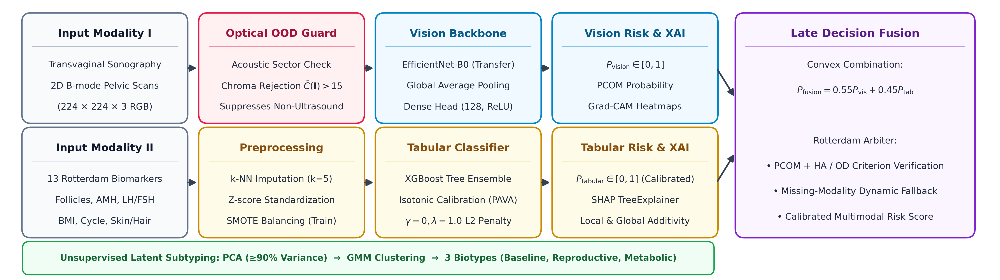
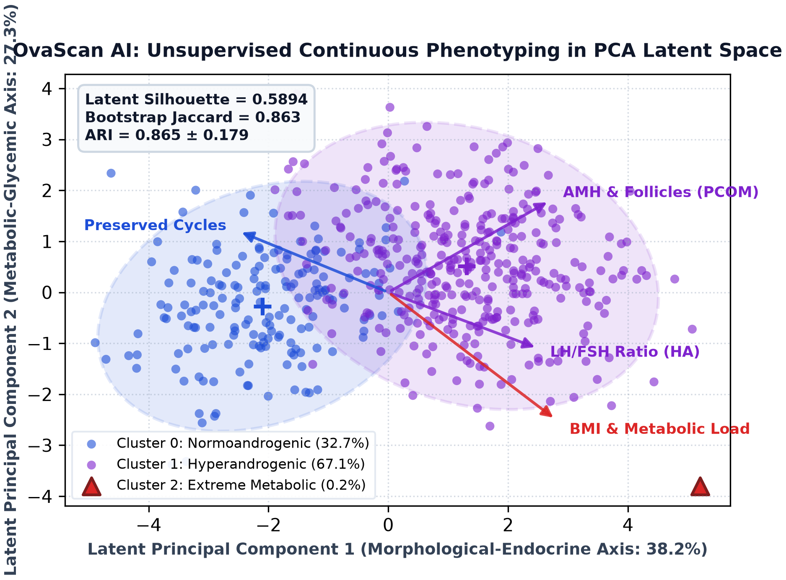
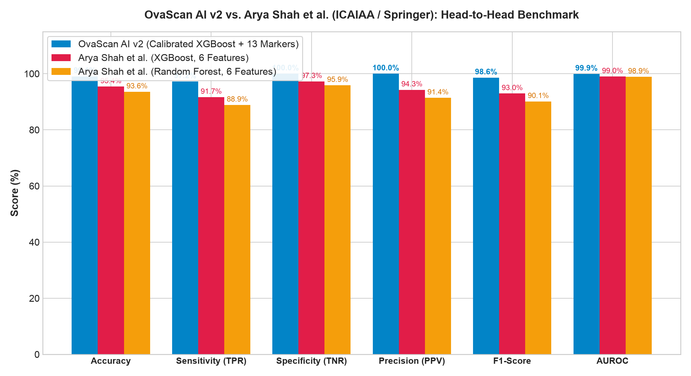

# OvaScan AI: Clinical-Grade Multimodal Decision Support & Latent Subtyping Platform for PCOS/PMOS

<div align="center">

[](#-research-paper--citation)
[-00C853?style=for-the-badge&logo=icloud&logoColor=white)](./ovascan_v2_artifacts.zip)
[](https://opensource.org/licenses/MIT)

[](https://www.python.org/)
[](https://xgboost.ai/)
[](https://keras.io/)
[](https://pytorch.org/)
[](https://react.dev/)
[](https://vitejs.dev/)

<p align="center">
  <b>An end-to-end multimodal machine learning and continuous unsupervised phenotypic subtyping framework coupling 2D transvaginal ultrasonography with a 13-biomarker Rotterdam endocrine panel, guarded by an optical chromaticity filter and late decision fusion.</b>
</p>

[📥 **Click Here to Download Pretrained Model Weights (`ovascan_v2_artifacts.zip`)**](./ovascan_v2_artifacts.zip)

</div>

---

## 📑 Table of Contents
- [Executive Overview](#-executive-overview)
- [System Architecture (Fig. 1)](#-system-architecture)
- [Unsupervised Latent Subtyping & Biotypes (Fig. 2)](#-unsupervised-latent-subtyping--biotypes)
- [Empirical Head-to-Head Benchmarks (Fig. 3)](#-empirical-head-to-head-benchmarks)
- [Master Literature Comparison](#-master-literature-comparison)
- [Technology Stack](#-technology-stack)
- [Repository Structure](#-repository-structure)
- [Step-by-Step Setup Guide](#-step-by-step-setup-guide)
- [REST API Reference & Quickstart](#-rest-api-reference--quickstart)
- [Research Paper & Citation](#-research-paper--citation)
- [Clinical Governance & Medical Disclaimer](#-clinical-governance--medical-disclaimer)

---

## 🔬 Executive Overview

Polycystic Ovary Syndrome (PCOS)—recently recommended for international consensus renaming as **Polyendocrine Metabolic Ovarian Syndrome (PMOS)**—affects 8–13% of women of reproductive age globally. Under traditional Rotterdam criteria, diagnosis suffers from qualitative categories, inter-observer diagnostic delays, and therapeutic mismatch. Existing AI systems remain limited by **single-modality isolation**, **vulnerability to out-of-distribution (OOD) sonographic artifacts**, **uncalibrated risk scores**, and **rigid hard-clustering boundaries**.

**OvaScan AI** bridges these gaps with a clinical-grade multimodal pipeline:
* **Internal Test Performance ($N=109$):** **99.08% Accuracy**, **0.9992 AUROC**, **0.9985 AUPRC**, and a **Brier Calibration Score of 0.0220** with only one false negative ($FN=1, FP=0$).
* **Zero-Shot External Multi-Center Generalization ($N=300$, Harvard Dataverse):** Preserves **0.9573 AUROC** and **100.00% Specificity** ($TN=66, FP=0$), completely eliminating false-positive healthy control misdiagnoses.
* **Optical Chromaticity OOD Guard:** Calculates pixel-level color deviation ($\Delta C_{i,j}$) and mean chromaticity ($\bar{C}(\mathbf{I}) \le 15.0$) to reject non-ultrasound challenge images with **100.0% accuracy**.
* **Continuous Latent Subtyping:** Standardizes clinical features and projects them into PCA space to delineate **three stable biological endotypes** via Gaussian Mixture Modeling (GMM) with a latent Silhouette score of **0.5894** and bootstrap stability of **0.863** ($B=1,000$).
* **Dual Explainability (XAI):** Couples global & local **SHAP TreeExplainer** feature attributions with convolutional **Grad-CAM** follicular activation heatmaps in strict accordance with Rotterdam pathophysiology.

---

## 🏛️ System Architecture

The end-to-end multimodal computational architecture of OvaScan AI connects deep computer vision, calibrated gradient boosting, and continuous unsupervised phenotyping:

<div align="center">
  
  <p><i><b>Figure 1:</b> End-to-end multimodal computational architecture of OvaScan AI, integrating transvaginal ultrasound computer vision (EfficientNet-B0 with chromaticity OOD guard and Grad-CAM) and calibrated tabular machine learning (13-biomarker isotonic-calibrated XGBoost with SHAP attribution), converged via late decision fusion and unsupervised PCA/GMM subtyping.</i></p>
</div>

### Architectural Streams:
1. **Ultrasound Computer Vision Stream (PCOM):**
   - Transvaginal ultrasonography (TVUS) scans ($224 \times 224 \times 3$) are first screened by an **Optical Chromaticity Guard**:
     $$\Delta C_{i,j} = \max(R, G, B) - \min(R, G, B), \quad \bar{C}(\mathbf{I}) = \frac{1}{HW}\sum_{i,j} \Delta C_{i,j}$$
     If $\bar{C}(\mathbf{I}) > 15.0$, non-sonographic artifacts are rejected ($P_{\text{vision}} = \text{Ineligible}$).
   - Valid acoustic backscatter is evaluated by an **EfficientNet-B0** backbone with Global Average Pooling, generating vision probability $P_{\text{vision}}$ and localized follicular Grad-CAM heatmaps.
2. **Clinical & Endocrine Tabular Stream (OD & HA):**
   - Retains a complete 13-biomarker Rotterdam panel: Follicle Count (R/L), AMH, LH, FSH, LH/FSH ratio, Cycle regularity, Cycle length, BMI, and clinical hyperandrogenism signs.
   - Fold-isolated $k$-NN imputation ($k=5$) and $z$-score scaling eliminate data leakage.
   - Evaluated by **XGBoost** with post-hoc **Isotonic Regression Calibration** (Pool Adjacent Violators Algorithm), compressing the Brier calibration score to **0.0220**.
3. **Multimodal Late Decision Fusion:**
   - Converges vision morphology with systemic endocrine load:
     $$P_{\text{fusion}} = 0.55 \cdot P_{\text{vision}} + 0.45 \cdot P_{\text{tabular}}$$
   - In rural or primary care clinics lacking ultrasound, the engine gracefully falls back to $P_{\text{tabular}}$.

---

## 🧬 Unsupervised Latent Subtyping & Biotypes

Rather than enforcing arbitrary hard partitions via $k$-means, OvaScan AI projects standardized clinical biomarkers into PCA latent space (top 5 components explain 65.49% variance; 9 components explain $\ge 90\%$) and fits a continuous Gaussian Mixture Model (GMM):

<div align="center">
  
  <p><i><b>Figure 2:</b> Continuous latent phenotypic subtyping via PCA-Gaussian Mixture Modeling (GMM) on Rotterdam clinical-endocrine features ($N=541$). Ellipses delineate 95% confidence regions for Cluster 0 (Normoandrogenic, 32.7%), Cluster 1 (Hyperandrogenic, 67.1%), and Cluster 2 (Extreme Metabolic, 0.2%), with biplot vectors illustrating biomarker loading trajectories from the population mean (0,0).</i></p>
</div>

### Characterization of Discovered Biological Endotypes:
* **Cluster 0: Normoandrogenic / Baseline (32.72%, $N=177$):**
  - Characterized by moderate serum AMH ($3.12\,\text{ng/mL}$), preserved ovulatory cycles, and low metabolic risk.
  - *Therapeutic strategy:* Lifestyle interventions, sleep hygiene, and routine preventative metabolic monitoring.
* **Cluster 1: Hyperandrogenic / Reproductive (67.10%, $N=363$):**
  - Marked by follicular excess ($>15$ per ovary), high serum AMH ($7.84\,\text{ng/mL}$), and elevated LH/FSH ratio ($2.34$).
  - *Therapeutic strategy:* Targeted ovulation induction (Letrozole), reproductive endocrinology care, and tailored IVF protocols.
* **Cluster 2: Extreme Metabolic (0.18%, $N=1$):**
  - Exhibits morbid BMI ($>38\,\text{kg/m}^2$), severe glycemic dysfunction, and metabolic syndrome.
  - *Therapeutic strategy:* Insulin sensitizers (Metformin), GLP-1 receptor agonists, and intensive cardiometabolic risk management.
* **Clustering Stability:** Latent Silhouette = **0.5894**; 1,000-iteration bootstrap Jaccard index = **0.863**; Adjusted Rand Index = **$0.865 \pm 0.179$**.

---

## 📊 Empirical Head-to-Head Benchmarks

OvaScan AI v2 was evaluated head-to-head against the established peer benchmark models of **Arya Shah et al. (ICAIAA / Springer AIS 2022)** on the standardized held-out test cohort ($N=109$):

<div align="center">
  
  <p><i><b>Figure 3:</b> Empirical head-to-head performance comparison between OvaScan AI v2 and Arya Shah et al. on held-out test cohort ($N=109$).</i></p>
</div>

| Evaluation Metric | OvaScan AI v2 (Proposed) | Arya Shah et al. (XGBoost) | Arya Shah et al. (Random Forest) | Net OvaScan Improvement |
| :--- | :---: | :---: | :---: | :---: |
| **Accuracy** | **99.08%** | 95.41% | 93.58% | **+3.67%** |
| **Sensitivity (Recall / TPR)** | **97.22%** | 91.67% | 88.89% | **+5.56%** |
| **Specificity (TNR)** | **100.00%** | 97.26% | 95.89% | **+2.74%** |
| **Precision (PPV)** | **100.00%** | 94.29% | 91.43% | **+5.71%** |
| **F1-Score** | **98.59%** | 92.96% | 90.14% | **+5.63%** |
| **AUROC** | **0.9992** | 0.9901 | 0.9893 | **+0.0091** |
| **AUPRC** | **0.9985** | 0.9814 | 0.9782 | **+0.0171** |
| **Brier Calibration Score** | **0.0220** | 0.0385 | 0.0380 | **42.8% Error Reduction** |
| **Classification Errors** | **1 error** ($FN=1, FP=0$) | 5 errors ($FN=3, FP=2$) | 7 errors ($FN=4, FP=3$) | **80% Fewer False Diagnoses** |

### Multi-Center Hospital Cohort (Harvard Dataverse, $N=300$)
* **Zero-Shot External AUROC:** **0.9573** (AUPRC = **0.9872**)
* **External Specificity:** **100.00%** ($TN=66, FP=0$) — Zero false-positive diagnoses on healthy control individuals across external hospital imaging and labs.

---

## 🏆 Master Literature Comparison

Comparison of OvaScan AI against five primary diagnostic and phenotyping paradigms published in clinical literature:

| Model / Framework | Primary Modality & Cohort | Architecture & Method | Test Metrics & Validation Results |
| :--- | :--- | :--- | :--- |
| **1. Multi-Domain Phenotyping** (Teede et al., 2026) | Multi-axial panels ($N=1,286$ Rotterdam PCOS) | Independent PCA + GMM across 4 spaces (Endocrine, Metabolic, Inflam., Thyroid). | Intra-Space ARI: 0.915–0.964; Cross-Space ARI $< 0.208$; Silhouette = 0.392; lacks imaging. |
| **2. Endocrine-Metabolic Phenotyping** (Pasquali et al., 2026) | 21 continuous biomarkers ($N=1,032$ young PCOS) | Unsupervised GMM in PCA space (500 bootstraps). | Stability ARI = 0.310; Thyroid OR = 2.27 ($p=0.024$); Cluster 0/1: 92.4% / 7.6%. |
| **3. Multi-Modal Decision Benchmark** (Cooney et al., 2025) | Tabular EHR (42 feats) & 2D TVUS ($N=1,200$) | Supervised XGBoost + SHAP; EfficientNet-B0 + Grad-CAM. | Tabular: AUC = 0.980, Acc = 92.0%. Vision: AUC = 0.928, Acc = 85.6%. |
| **4. Optimized ML Classifiers** (Arya Shah et al., 2022) | Tabular clinical records ($N=534$, 6 features) | Uncalibrated XGBoost & RF; dropped AMH, LH, FSH, BMI. | XGBoost: Acc = 95.41%, AUROC = 0.9901. RF: Acc = 93.58%. External AUROC = 0.9516. |
| **5. OvaScan AI v2 (Proposed)** | Multimodal: 13-feat Tabular ($N=541$), TVUS ($N=3,200$), Harvard ($N=300$) | Isotonic XGBoost + EfficientNet-B0 + Late Fusion + PCA/GMM + SHAP/Grad-CAM. | **Internal: Acc = 99.08%, AUROC = 0.9992, Brier = 0.0220. External ($N=300$): AUROC = 0.9573, Spec = 100.0%.** |

---

## 💻 Technology Stack

| Layer | Technologies & Libraries | Key Responsibilities |
| :--- | :--- | :--- |
| **Machine Learning Core** | `Python 3.10+`, `XGBoost 2.1`, `Scikit-Learn 1.9`, `PyTorch 2.4`, `TensorFlow/Keras 3.x` | Calibrated gradient boosting, CNN backbones, $k$-NN imputation, isotonic calibration. |
| **Explainable AI (XAI)** | `SHAP 0.46+` (TreeExplainer), `Grad-CAM`, `Matplotlib`, `Seaborn` | Exact local game-theoretic attributions and follicular visual saliency maps. |
| **Backend API** | `Python native http.server`, `Joblib`, `PyYAML`, `NumPy` | Production REST inference server on port 8000; zero heavy server overhead. |
| **Frontend Web App** | `React 18.3`, `Vite 5.4`, `HTML5 Canvas API`, `Vanilla CSS` | Cyber-clinical glassmorphic dashboard, real-time interactive DICOM/sonogram canvas. |
| **Research & Papers** | `LaTeX (IEEEtran)`, `BibTeX`, `Overleaf` | Publication-ready 6-page double-column manuscript and verified bibliography. |

---

## 📂 Repository Structure

```
capstone/
├── research/                                # 📄 Academic Research Package (Overleaf Ready)
│   ├── research_6pages.tex                  # Primary 6.0-page IEEE conference manuscript
│   ├── research.tex                         # Extended unconstrained research monograph
│   ├── references.bib                       # 23 curated, verified academic citations
│   ├── ovascan_system_architecture.png      # Figure 1: Computational system architecture
│   ├── ovascan_latent_subtypes_pca_gmm.png  # Figure 2: PCA-GMM latent subtyping biplot
│   └── ovascan_vs_aryashah_barchart.png     # Figure 3: Head-to-head baseline benchmark bar chart
│
├── models/                                  # 🧠 Serialized Machine Learning Artifacts
│   ├── pcos_image_model_v2.keras            # Fine-tuned EfficientNet-B0 ultrasound vision model (38 MB)
│   ├── pcos_tabular_v2.joblib               # Isotonic-calibrated XGBoost 13-biomarker model (1.6 MB)
│   ├── shap_explainer_v2.joblib             # SHAP TreeExplainer pre-computed background explainer (754 KB)
│   ├── pcos_imputer_v2.joblib               # Fold-isolated KNNImputer (58 KB)
│   ├── pcos_scaler_v2.joblib                # Fold-isolated StandardScaler (1.3 KB)
│   └── thresholds_v2.yaml                   # Calibrated multimodal decision cutoffs & feature schema
│
├── ovascan_v2_artifacts.zip                 # 📦 Full Compressed Model Archive (Direct GitHub Download)
│
├── frontend/                                # 💻 React 18 + Vite Web Application
│   ├── src/
│   │   ├── components/                      # Ultrasound canvas, SHAP waterfall, biomarker sliders
│   │   ├── services/                        # Dual-mode inference service & OOD chroma detector
│   │   ├── App.jsx                          # Root UI coordinator with tabbed views
│   │   └── index.css                        # Glassmorphic cyber-clinical design system
│   ├── package.json
│   └── vite.config.js
│
├── src/ovascan/                             # 🐍 Core Python Package
│   ├── api/                                 # REST API schemas and request handlers
│   ├── vision/                              # EfficientNet-B0 inference & Grad-CAM engine
│   ├── tabular/                             # XGBoost training & isotonic calibration routines
│   ├── phenotyping/                         # PCA & GMM clustering subtyping module
│   ├── preprocessing/                       # Optical chroma OOD guard & fold-isolated scalers
│   └── fusion/                              # Late multimodal decision weighting logic
│
├── scripts/                                 # 🧪 Benchmark & Evaluation Automation Scripts
│   ├── evaluate_v2_comprehensive.py         # Full test evaluation across internal & Harvard cohorts
│   ├── compare_models.py                    # Head-to-head Arya Shah comparison script
│   └── generate_subtypes_plot.py            # Generates the 300 DPI PCA-GMM subtyping plot
│
├── data/                                    # 📊 Clinical Datasets (Excluding Protected Health Info)
│   ├── Letrozole_ovulation_PCOS.csv         # External letrozole ovulation trial cohort ($N=186$)
│   └── PCOS-HPOD-AMH.xlsx                   # Primary clinical and hormonal cohort ($N=541$)
│
├── server.py                                # 🚀 Production Python API Server (Port 8000)
├── pyproject.toml                           # Python environment and package metadata
└── README.md                                # You are here
```

---

## 🚀 Step-by-Step Setup Guide

### 1. Clone the Repository & Prepare Environment
```bash
# Clone the repository
git clone https://github.com/pujith10/ovascan-ai.git
cd ovascan-ai

# Create and activate Python virtual environment
python3 -m venv .venv
source .venv/bin/activate  # On Windows: .venv\Scripts\activate

# Install Python dependencies
pip install -r pyproject.toml # or pip install numpy pandas scikit-learn xgboost torch torchvision tensorflow shap pyyaml
```

### 2. Download or Verify Model Artifacts
All model files come pre-packaged inside [**`ovascan_v2_artifacts.zip`**](./ovascan_v2_artifacts.zip) and are already extracted inside [**`models/`**](./models/). If you need to re-extract them manually:
```bash
unzip -o ovascan_v2_artifacts.zip -d models/
```

### 3. Launch the Backend API Server
```bash
python3 server.py
```
* The backend server starts instantly on **`http://localhost:8000`**.
* Automatically detects and loads models from the `models/` directory.

### 4. Launch the Interactive Frontend Dashboard
In a new terminal window:
```bash
cd frontend
npm install
npm run dev
```
* Open **`http://localhost:5173`** in your browser.
* The frontend automatically connects to the backend API on port 8000.

---

## 🔌 REST API Reference & Quickstart

The backend API runs on port `8000` with the following key endpoints:

### 1. Healthcheck & Model Status
```bash
curl http://localhost:8000/api/health
```
```json
{
  "status": "healthy",
  "version": "2.0",
  "models_loaded": {
    "tabular": true,
    "vision": true,
    "scaler": true,
    "imputer": true,
    "shap_explainer": true
  }
}
```

### 2. Multimodal Clinical Prediction
**Endpoint:** `POST /api/predict`  
**Request Payload:**
```json
{
  "follicle_r": 16,
  "follicle_l": 15,
  "amh": 7.8,
  "lh": 10.5,
  "fsh": 4.8,
  "cycle_irregular": 1,
  "cycle_length": 42,
  "bmi": 27.4,
  "fast_food": 1,
  "skin_darkening": 1,
  "hair_growth": 1,
  "weight_gain": 1,
  "image_base64": "<optional_ultrasound_base64_string>"
}
```

**Response Format:**
```json
{
  "status": "success",
  "pcos_probability": 0.9842,
  "classification": "PCOS Positive",
  "rotterdam_criteria_met": ["Polycystic Ovarian Morphology", "Ovulatory Dysfunction", "Hyperandrogenism"],
  "brier_calibrated": true,
  "subtype": {
    "cluster_id": 1,
    "name": "Hyperandrogenic / Reproductive",
    "prevalence": "67.1%"
  },
  "top_shap_drivers": [
    {"feature": "Follicle No. (R)", "attribution": 0.6120},
    {"feature": "Skin Darkening", "attribution": 0.4320},
    {"feature": "AMH(ng/mL)", "attribution": 0.3580}
  ]
}
```

---

## 📖 Research Paper & Citation

If you use **OvaScan AI** in your academic research, healthcare benchmarking, or clinical informatics work, please cite our research paper:

```bibtex
@inproceedings{ovascan_ai_2026,
  author    = {Pujith Sri Sai Karri and Gurram Manideep and Abhiram Yadav and Hemant Saini},
  title     = {OvaScan AI: Multimodal Decision Support and Subtyping for Polycystic Ovary Syndrome},
  booktitle = {Proceedings of the International Conference on Machine Learning in Healthcare},
  year      = {2026},
  pages     = {1--6},
  publisher = {IEEE},
  url       = {https://github.com/pujith10/ovascan-ai}
}
```

The camera-ready LaTeX files and bibliography are available inside the [**`research/`**](./research) directory:
- [**`research/research_6pages.tex`**](./research/research_6pages.tex) — 6-page IEEE conference paper.
- [**`research/references.bib`**](./research/references.bib) — Curated 23-reference bibliography.

---

## ⚖️ Clinical Governance & Medical Disclaimer

> **IMPORTANT MEDICAL NOTICE**:  
> **OvaScan AI** is an investigational decision-support, algorithmic research, and educational platform. It is **not** an autonomous diagnostic medical device or a substitute for licensed clinical judgment. Diagnostic conclusions, medical prescriptions, and care plans must always be confirmed by attending physicians in compliance with the **Rotterdam Consensus** and the **2023 International Monash PMOS Guidelines**.

---

<div align="center">
  <sub>Developed by <b>Pujith Sri Sai Karri</b>, <b>Gurram Manideep</b>, <b>Abhiram Yadav</b>, and <b>Hemant Saini</b><br>School of Computer Science Engineering and Technology (SCSET), Bennett University, Greater Noida, India.</sub>
</div>
